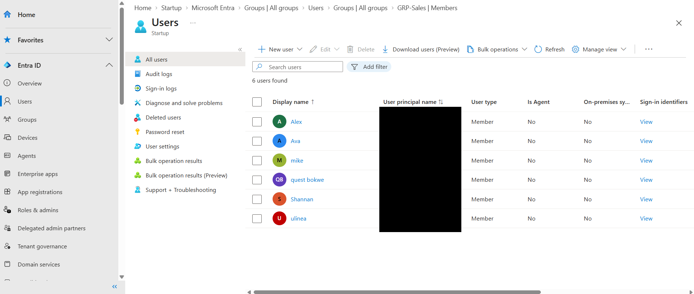
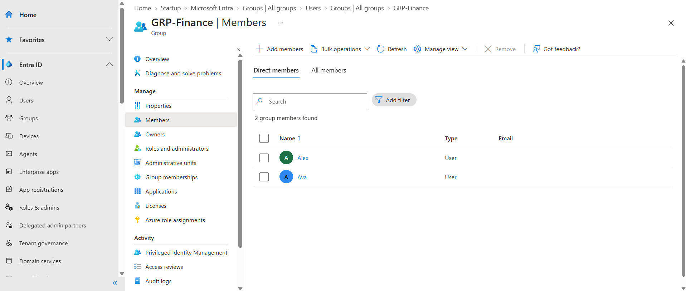
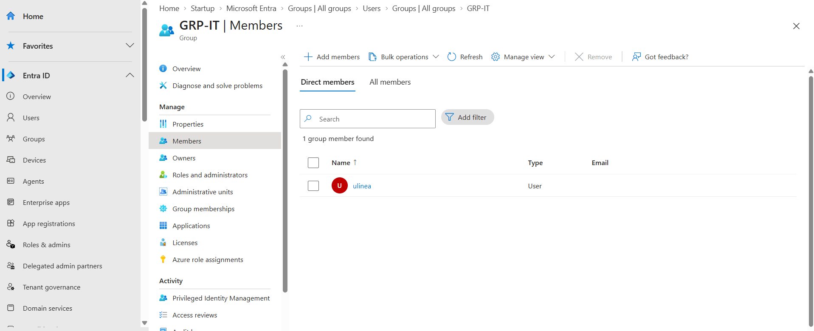
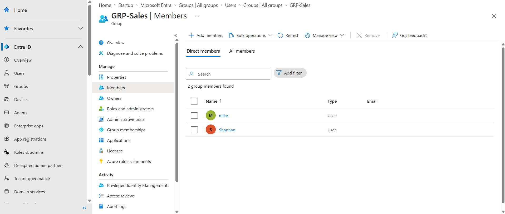
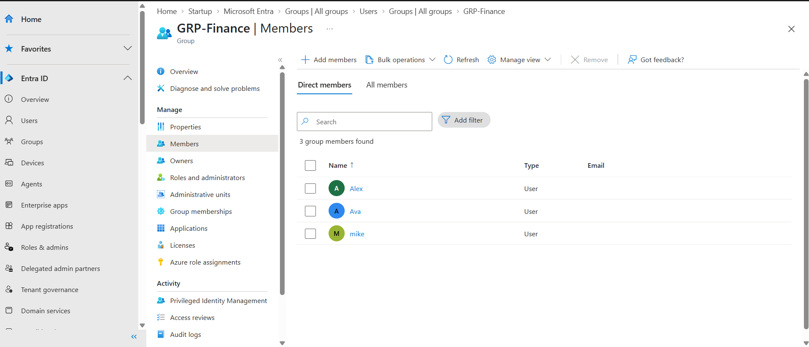
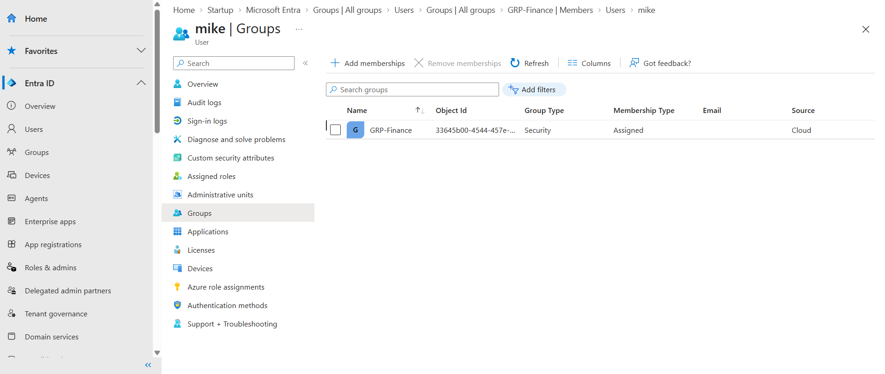
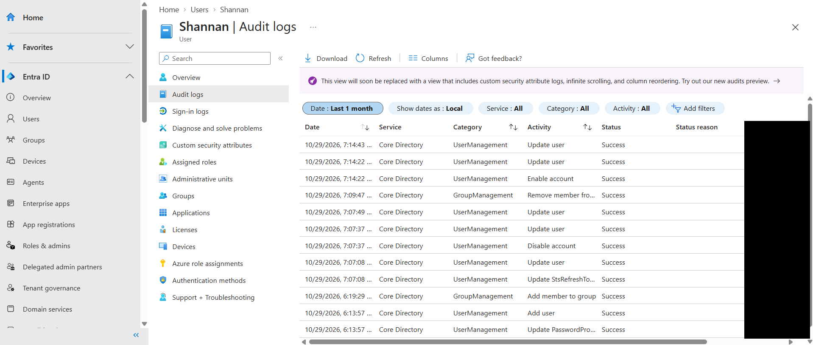

# Lab 01: Joiner/Mover/Leaver Lifecycle in Microsoft Entra ID

## Goal
Show the full identity lifecycle in a test tenant: give new users the right access through groups, change that access when someone moves departments, and remove it when someone leaves. Each stage is backed by audit and sign-in log evidence.

## Environment
- Personal Microsoft Entra ID test tenant (free tier), fake users only
- Entra admin center (manual run)
- Completed: October 29, 2026

## Design
| Department | Group | Users |
|------------|-------|-------|
| Finance | GRP-Finance | Alex, Ava |
| IT | GRP-IT | ulinea |
| Sales | GRP-Sales | mike, Shannan |

Planned changes: mike moves from Sales to Finance, and Shannan leaves the company.

## What I did

### Joiner
I created three security groups with assigned membership and five users, each with a department and job title. I added every user to the group for their department. Ava then signed in with her temporary password, was forced to change it, and registered MFA.

### Mover
mike moved from Sales to Finance. I removed him from GRP-Sales first, then added him to GRP-Finance, then updated his department and job title. Removing first meant he never held both sets of access. The audit log shows the removal at 10:54 UTC and the new membership at 10:56 UTC.

### Leaver
For Shannan I revoked sessions, disabled the account, and removed him from GRP-Sales. He had no licenses assigned. The audit log shows each step in that order.

### Evidence
Full audit and sign-in log tables are in [evidence.md](evidence.md), and the same data is in `data/audit-log-sanitized.csv` and `data/signin-log-sanitized.csv`. Emails, IP addresses, and IDs are removed.

## What broke
**1. Ava's first password change failed once.**
The audit log shows a failed self-service password change at 10:42:54 UTC. The recorded reason was `CloudPasswordPolicyError` (`WeakPasswordException`), which means the new password I chose did not meet the tenant's password policy. I retried with a password that met the policy, and the change succeeded about a minute later.

**2. I could not reset Shannan's password while his account was disabled.**
I had lost his temporary password and wanted to test the blocked sign-in. The portal refused the reset because the account was disabled. I enabled the account at 11:14 UTC to attempt it, then disabled it again at 11:21 UTC. I did not finish the reset, so the blocked sign-in was not tested. The audit log is my evidence that the account is disabled.

**Lesson:** save every temporary password when creating a user, and do the sign-in test before disabling a leaver.

## Leaver retention decision
Disable the account and revoke sessions on the last day. Remove group memberships and licenses at the same time. Keep the disabled account for 30 days for handovers, then delete it. Entra keeps deleted users restorable for a further 30 days. Accounts under legal hold stay disabled until released.

## Validation
- [x] Each joiner has the department and group from the design table
- [x] mike holds only Finance access after the move
- [x] Shannan's account is disabled, his sessions were revoked, and he has no groups or licenses
- [x] Audit log entries exist for every change
- [ ] Shannan's blocked sign-in attempt was not tested

## Takeaways
- **Groups over per-user access:** one membership change moved mike's access, and one removal ended Shannan's group access.
- **Removal before grant:** the order in the log shows the old access ended before the new access started, which prevents access creep.
- **Evidence matters:** the audit log proved every stage, including my own mistakes.
- **Disable before cleanup:** a disabled account cannot have its password reset, so tests that need credentials come first.
- **Next steps:** automate the lifecycle with Microsoft Graph PowerShell and compare assigned groups with dynamic groups.
