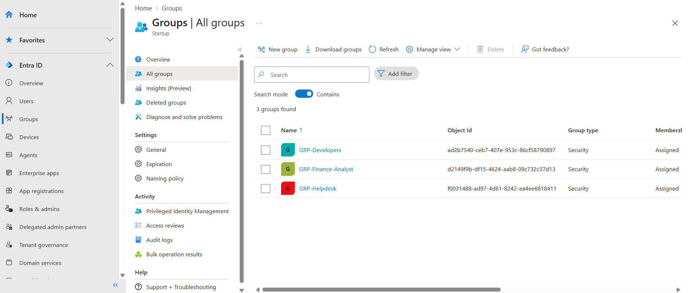
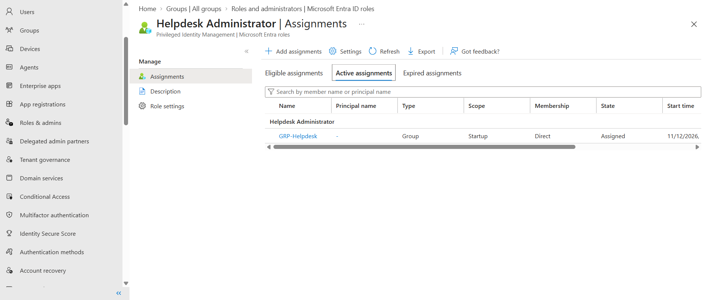
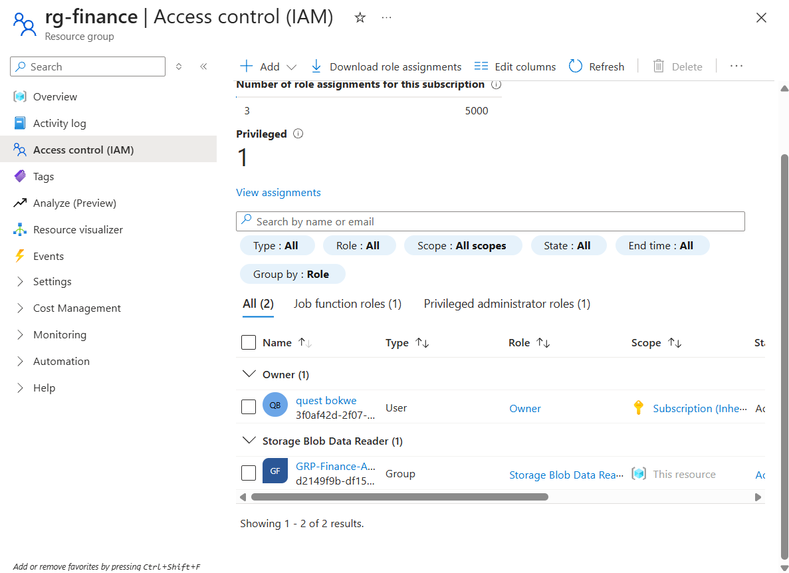
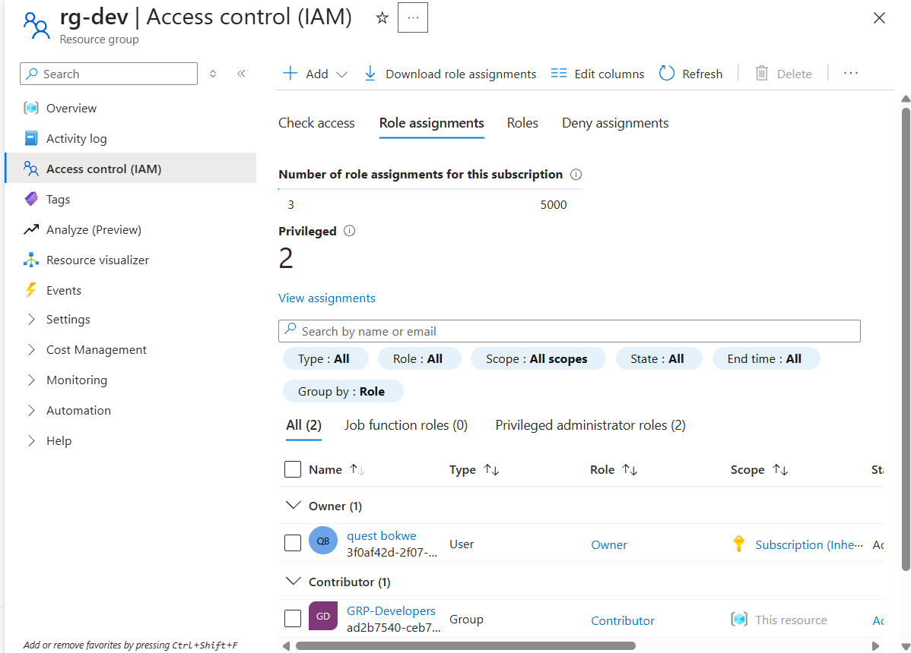
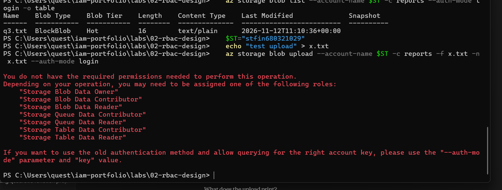
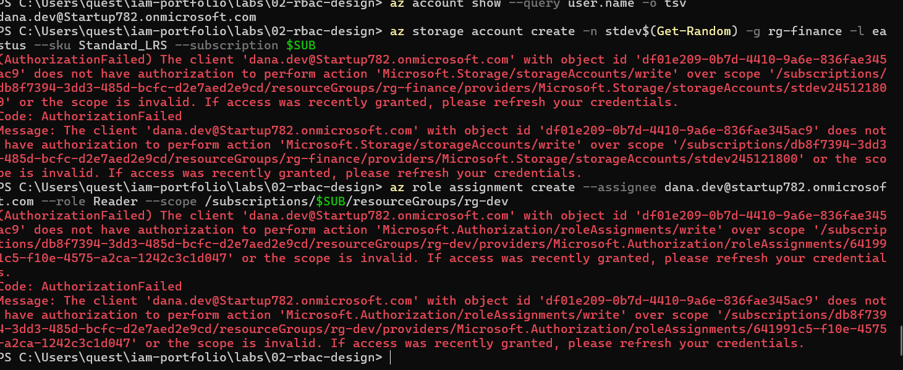
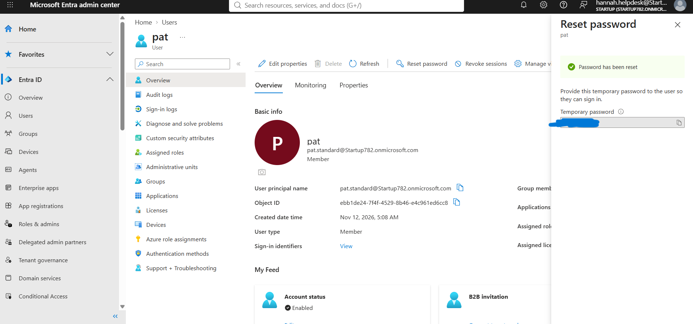
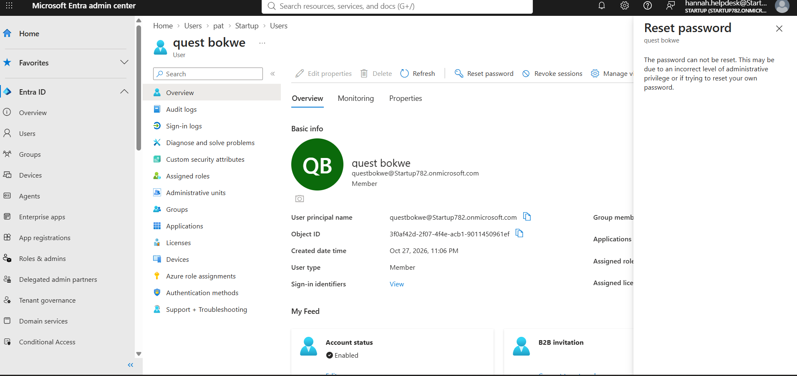

# Lab 02: Role-Based Access Control with Groups in Microsoft Entra ID and Azure

## Goal
Show least-privilege access in a test tenant: assign one Entra role and two Azure roles to groups instead of users, then prove that each persona can do what its role allows and is blocked from everything else. Each result is backed by CLI output, portal screenshots, and a role assignment check.

## Environment
- Personal Microsoft Entra ID test tenant with the Microsoft Entra ID P2 trial, Azure subscription "Azure subscription 1", fake users only
- Entra admin center and Azure portal (manual run)
- Azure Cloud Shell as admin, local Azure CLI for the persona tests
- Tested: November 12, 2026

## Design
| Persona | User | Group | Role | Scope |
|---------|------|-------|------|-------|
| Help desk | Hannah | GRP-Helpdesk | Helpdesk Administrator (Entra role) | Directory |
| Finance | Fiona | GRP-Finance-Analyst | Storage Blob Data Reader | rg-finance |
| Developer | Dana | GRP-Developers | Contributor | rg-dev |
| Standard user | Pat | none | none | Target of Hannah's password reset |

GRP-Helpdesk is a role-assignable group, so it can hold an Entra role. No role is assigned directly to a user. The only user-level role in the subscription is my admin account's Owner, inherited from the subscription.

Planned cleanup: delete both resource groups after testing and keep the users and groups for Labs 03 and 05.

## What I did

### Entra role
I created four users and three security groups. GRP-Helpdesk was created with Microsoft Entra roles can be assigned to the group set to Yes, then I assigned Helpdesk Administrator to the group, not to Hannah. Hannah's later password reset on Pat worked, which only the group role could have allowed.

<!-- Add if saved:  -->

### Azure roles
I created rg-finance and rg-dev, a storage account in rg-finance with public blob access disabled, and a container called reports with a fake file, q3.txt. Owner does not include blob data access, so I gave myself a temporary Storage Blob Data Contributor role to upload the file. I then assigned Storage Blob Data Reader to GRP-Finance-Analyst on rg-finance and Contributor to GRP-Developers on rg-dev, and removed my temporary role.

### Persona tests
**Finance (Fiona):** listing the reports container showed q3.txt. Uploading a new file was denied, because Reader grants read access only.

**Developer (Dana):** creating a storage account in rg-dev succeeded. The same command in rg-finance failed with AuthorizationFailed. Assigning herself the Reader role also failed with AuthorizationFailed, because Contributor cannot write role assignments.

**Help desk (Hannah):** she reset Pat's password in the Entra admin center. Resetting my admin account's password was refused, and Edit properties and Delete were greyed out on that account.

### Validation check
As admin, I listed every role assignment held by a user across the subscription. Only my admin account appeared, as Owner at the subscription scope.

### Evidence
Command output, timestamps, and error text are in [evidence.md](evidence.md). Emails, subscription and tenant IDs, object IDs, and IP addresses are removed.

## What broke
**1. Azure CLI had no session in Cloud Shell.**
Every `az` command failed with "Please run 'az login' to setup account", so my first attempt created nothing. The Subscriptions page showed "Filtered (0 of 1)", which meant a subscription existed but the portal's Advanced filters (Default) was hiding it. I turned Advanced filters off in Portal settings, opened a fresh Cloud Shell, and `az account show` worked. I never confirmed why the CLI had no session before that.

**2. Azure CLI sign-in was blocked with error 530035.**
Three `az login --use-device-code` attempts ended in "You don't have access to this" with error 530035 and app name Microsoft Azure CLI (admin twice, Fiona once). The sign-in logs were too slow to load, so I did not confirm the reason. A normal browser login with `az login --allow-no-subscriptions` worked for Fiona and Dana, so the device code flow may be what was blocked. That is a guess.

**3. The first storage account create failed with SubscriptionNotFound.**
The resource groups were created in the same run, but the storage command returned `SubscriptionNotFound`. The retry succeeded at 11:09 UTC. I did not capture whether registering the Microsoft.Storage provider was needed.

**4. Fiona's first blob list was denied.**
About 19 minutes after the role assignment, the list failed with "You do not have the required permissions". After `az logout` and a new `az login`, the same command listed q3.txt. My best explanation is a stale token, since roles are read at sign-in. I did not check her group membership, so this is not confirmed.

**5. Dana could not see the subscription.**
`az account list` showed only the tenant-level account, and the create command failed with "Subscription not recognized". In the portal she saw "Don't have a subscription?", and opening rg-dev returned a 401 on `resourceGroups/read`. After signing in again, the create in rg-dev succeeded at 11:52 UTC. Same likely cause as Fiona's, and also not confirmed.

**6. I ran the first help desk denial as the wrong user.**
My first screenshot of a refused password reset was signed in as my admin account, not Hannah, so it proved nothing about her role. I discarded it and repeated the test as Hannah, which was also refused.

**7. Smaller issues.**
My PowerShell variables were empty in a new session, so `--account-name` failed with "expected one argument". Hannah's license page also pointed to the Microsoft 365 admin center for assignments, though the P2 license was already active.

**Lesson:** after any role or group change, sign out and back in before testing, and check the top right of every screenshot to confirm who is signed in.

## Design decisions
Roles go to groups so that access follows membership, and removing a person from a group removes their access. Azure roles are scoped to a single resource group, so Fiona's read access cannot reach rg-dev and Dana's write access cannot reach rg-finance. Contributor was chosen for developers because it lets them manage resources but not grant access, which Dana's failed role assignment confirmed. My temporary data role was removed right after seeding, so the final state has no standing user-level data access.

## Validation
- [x] Fiona can read blobs in rg-finance and cannot upload
- [x] Dana can create resources in rg-dev, cannot create them in rg-finance, and cannot assign roles
- [x] Hannah can reset Pat's password through the group-assigned Helpdesk Administrator role
- [x] No role is assigned directly to a user except my admin's inherited Owner
- [x] Hannah cannot reset the password of my admin account

## Takeaways
- **Groups over per-user access:** every role in this lab sits on a group, and the validation query proves no user holds one directly.
- **Scope limits blast radius:** the same user type got read access in one resource group and none in the other.
- **Owner is not data access:** I needed a temporary data role just to upload one file.
- **Role changes need a new sign-in:** Fiona and Dana both failed until they signed in again.
- **Evidence matters:** the logs and screenshots covered my mistakes as well as my results.
- **Next steps:** reuse these users and groups in Labs 03 and 05, and try eligible assignments with Privileged Identity Management.
