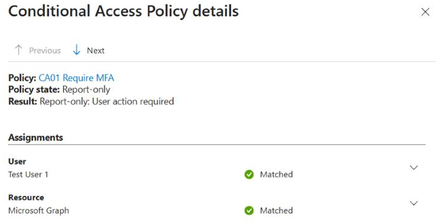
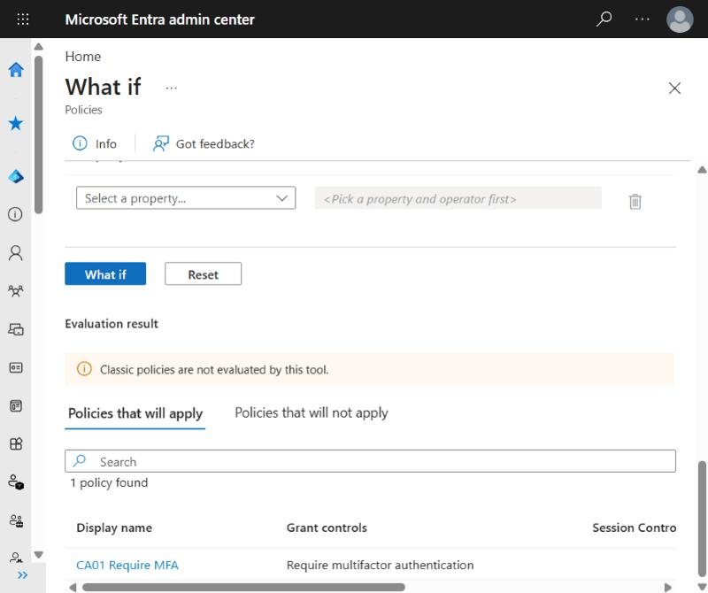
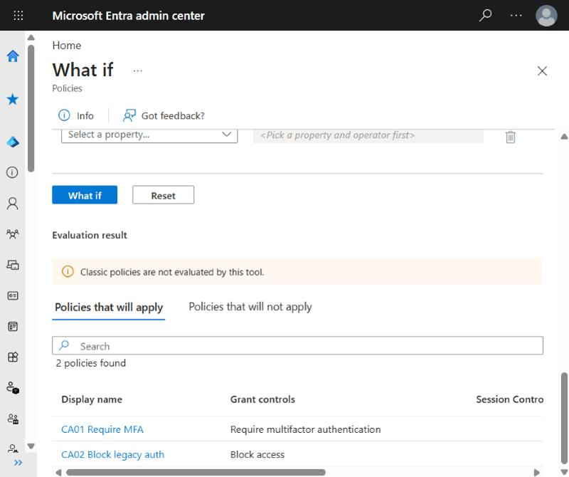
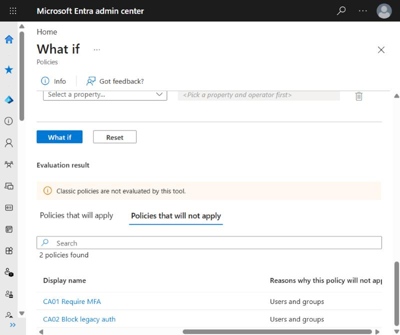
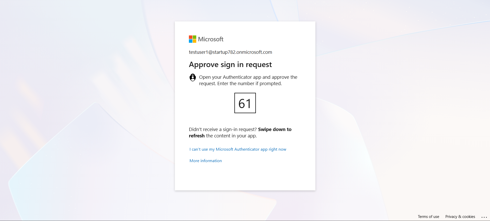

# Lab 03: Conditional Access and MFA

## Goal
Require MFA for all users and block legacy authentication with Conditional Access, testing in report-only mode before enforcing.

## Environment
Microsoft Entra ID P2 trial, single tenant with 7 users. Everything was done in the Microsoft Entra admin center (entra.microsoft.com). Completed: 2026-11-26

## Safety setup
Before I built any policy, I made sure I couldn't lock myself out of the tenant.

**1. Created a break-glass account**
- Identity → Users → New user → Create new user
- User principal name: `breakglass@<tenant>.onmicrosoft.com`, display name **Break Glass Admin**
- Left *Auto-generate password* on and stored the password offline
- On the **Assignments** tab: Add role → **Global Administrator**
- The account is cloud-only, with no licenses and no MFA registration, so it doesn't depend on anything else working

**2. Created the exclusion group**
- Identity → Groups → New group
- Group type **Security**, name **GRP-BreakGlass**, membership type **Assigned**
- Description: *Emergency access accounts. Excluded from all Conditional Access policies.*
- Members: Break Glass Admin only

**3. Created a test user**
- `testuser1@<tenant>.onmicrosoft.com`, display name **Test User 1**, regular member with no admin roles
- I used this account for every sign-in test so I never had to risk my own admin account

**4. Left security defaults ON** until both policies had been built and tested in report-only (see Enforcement).

## Policies
| Policy | Users | Target | Condition | Grant |
|--------|-------|--------|-----------|-------|
| CA01 Require MFA | All users, exclude GRP-BreakGlass | All resources (formerly All cloud apps) | None | Require MFA |
| CA02 Block legacy auth | All users, exclude GRP-BreakGlass | All resources (formerly All cloud apps) | Client apps: Exchange ActiveSync, Other clients | Block |

**How I built CA01 Require MFA** (Protection → Conditional Access → Policies → New policy)
1. Name: `CA01 Require MFA`
2. Users → Include: **All users** → Exclude: Users and groups → **GRP-BreakGlass**
3. Target resources → Include: **All resources (formerly 'All cloud apps')**
4. Grant → Grant access → **Require multifactor authentication**
5. Enable policy: **Report-only** → Create

**How I built CA02 Block legacy auth**
1. Name: `CA02 Block legacy auth`
2. Users and target resources: same as CA01 (All users, exclude GRP-BreakGlass, All resources)
3. Conditions → Client apps → Configure **Yes**. The portal ticks all four boxes by default, so I **unticked Browser and Mobile apps and desktop clients**. Only **Exchange ActiveSync clients** and **Other clients** stayed ticked. Leaving the modern clients ticked would have blocked everyone.
4. Grant → **Block access**
5. Enable policy: **Report-only** → Create

When I saved each policy, the portal showed a **"Don't lock yourself out!"** warning with **"Exclude current user" already selected**. I switched it to **"I understand that my account will be impacted by this policy"** because I wanted my admin account covered by MFA too. The only intended exclusion is GRP-BreakGlass.

## Report-only testing
**Sign-in test.** I reset Test User 1's password (Users → Test User 1 → Reset password), opened a private browser window, and signed in at `myapps.microsoft.com`. Security defaults were still on, so testuser1 was made to set a new password and register MFA.

**Sign-in logs.** Monitoring → Sign-in logs → opened each testuser1 sign-in → **Report only** tab:

| Sign-in (UTC) | CA01 Require MFA | CA02 Block legacy auth |
|---|---|---|
| 02:02 | Report-only: **User action required** (would have prompted for MFA) | Report-only: Not applied |
| 02:04 | Report-only: **Success** ("MFA requirement satisfied by claim in the token") | Report-only: Not applied |

The two sign-ins got different CA01 results. On the first one, testuser1 had no MFA claim yet, so CA01 *would have* forced MFA. Security defaults then had testuser1 register and complete MFA. By the second sign-in the token already carried an MFA claim, so CA01 counted as satisfied. CA02 was **Not applied** both times, which is correct because a browser is a modern-auth client.

**What If tool.** Conditional Access → Policies → What If. User: Test User 1, cloud app: Office 365 Exchange Online, device platform: Windows.

| Client app | Policies that apply | Policies that don't apply |
|---|---|---|
| Browser | CA01 (Require MFA) | CA02, reason: *Client app* |
| Mobile apps and desktop clients – Other clients (legacy) | CA01 (Require MFA), **CA02 (Block access)** | none |

I also ran What If with **Break Glass Admin** as the user. Both policies showed under *Policies that will not apply* with the reason **Users and groups**, which confirms the GRP-BreakGlass exclusion works.

## Enforcement
1. **Disabled security defaults.** Identity → Overview → Properties → Manage security defaults → **Disabled**, with the reason *"My organization is planning to use Conditional Access"* → Save → confirmed **Disable**.
2. **Switched both policies On right away.** I opened CA01, set Enable policy to **On**, kept "I understand that my account will be impacted", and saved. Then I did the same for CA02. Both were On within about a minute of security defaults going off, so the tenant was never unprotected for long. The portal said *"Policy will be enabled in a few minutes."*
3. **Tested enforcement.** After waiting a few minutes, I opened a **new** private window (an old window can reuse a cached session) and signed in as testuser1. I **was prompted for MFA**: an **"Approve sign in request"** screen asking me to open Microsoft Authenticator and enter the number shown (number matching). I approved it with the Authenticator app registered during the report-only phase.

The sign-in log shows the handover clearly. testuser1's sign-ins at 02:15 UTC, just before the switch, list **Security Defaults → Success** on the Conditional access tab, so security defaults were still the control in effect. After the switch, the MFA prompt came from CA01 instead.

## What broke
- **Problem:** Sign-in logs lagged about 20 minutes. testuser1's sign-ins didn't appear under Monitoring → Sign-in logs until long after they happened, so I couldn't check the report-only result right away. At one point the newest log entry was 8:52 PM when the time was already 9:11 PM.
- **Cause:** Entra sign-in log ingestion delay, common on trial tenants. The **Audit logs** showed Authentication Methods activity at 9:04 PM, right when testuser1 was signing in, much sooner than the sign-in log did.
- **Fix:** I used the What If tool for immediate validation, confirmed the activity in the audit log, and waited for the sign-in log to catch up before taking the report-only screenshot.

Other things I ran into:
- Every policy screen warned *"You must first disable security defaults before enabling a Conditional Access policy."* Report-only policies can be created and evaluated while security defaults are on, but they can't be set to **On** until security defaults are off. That decided my order: build in report-only → validate → disable security defaults → enforce immediately.
- My first legacy-auth What If run returned **zero** applying policies. I found that **Break Glass Admin** was selected instead of testuser1, because I clicked the first row before the user search finished filtering. I fixed the selection and re-ran it. The wrong run still proved useful as evidence that the break-glass exclusion works.

## Validation
- [x] Break-glass account is excluded. What If for Break Glass Admin shows CA01 and CA02 under *Policies that will not apply*, reason **Users and groups**. *(Checked with What If; I didn't do a live break-glass sign-in after enforcement.)*
- [x] Test user is prompted for MFA after CA01 is On. testuser1 sign-in from a fresh private window showed the MFA prompt.
- [x] Legacy auth is blocked. What If for testuser1 with client app *Other clients* shows **CA02 Block access** under *Policies that will apply*. *(Checked with What If; no real legacy-protocol client was used.)*

## Takeaways
- **Report-only comes first** because a policy targeting "All users + All resources" can lock out every account, including the admin who created it. Report-only showed me exactly what *would* happen (User action required, Not applied) with no user impact, and confirmed CA02 ignores browser sign-ins before it could block anything. It also taught me that a token that already carries an MFA claim satisfies CA01, so one report-only sign-in isn't the full picture.
- **Don't trust the portal's defaults.** The lockout warning preselects "Exclude current user", and the Client apps condition preselects every client type. Accepting either would have quietly weakened a policy: the first leaves the admin account out of MFA, the second makes CA02 block all sign-ins.
- **Monitoring break-glass use:** the break-glass account should never sign in during normal operations, so any sign-in is an alert. I'd send Entra sign-in and audit logs to Log Analytics / Microsoft Sentinel and create alert rules for:
  - any sign-in by `breakglass@` (or any GRP-BreakGlass member)
  - any change to GRP-BreakGlass membership, since adding someone bypasses every policy
  - any edit to the exclusions on CA01/CA02
